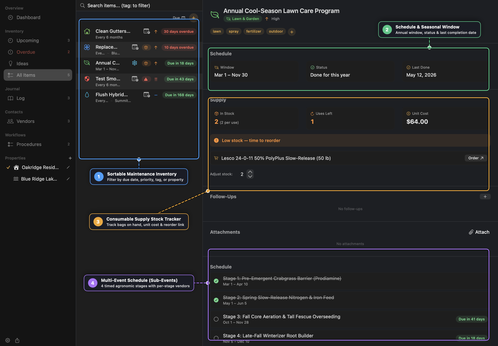
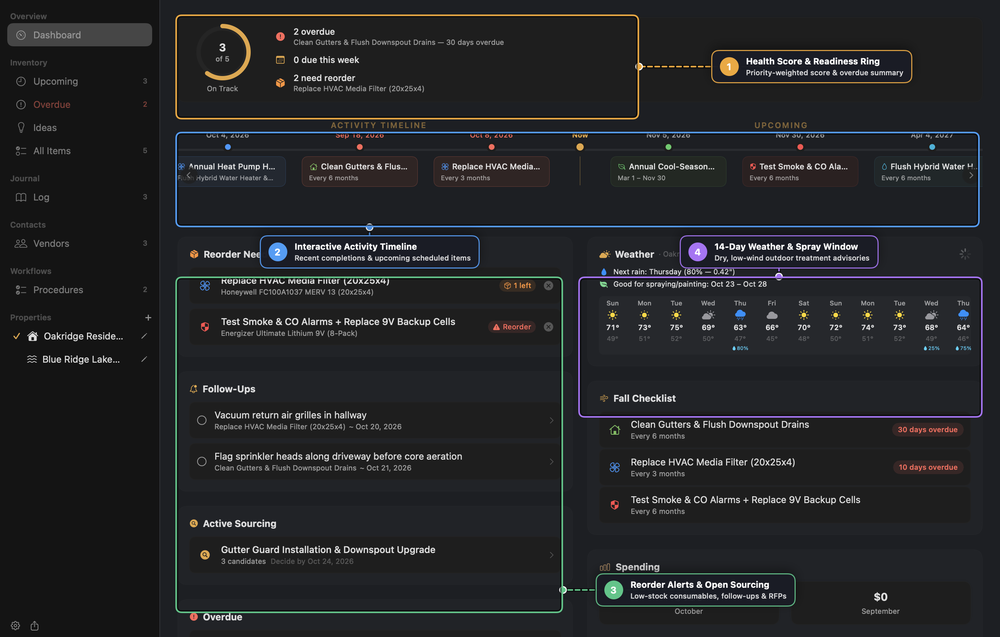
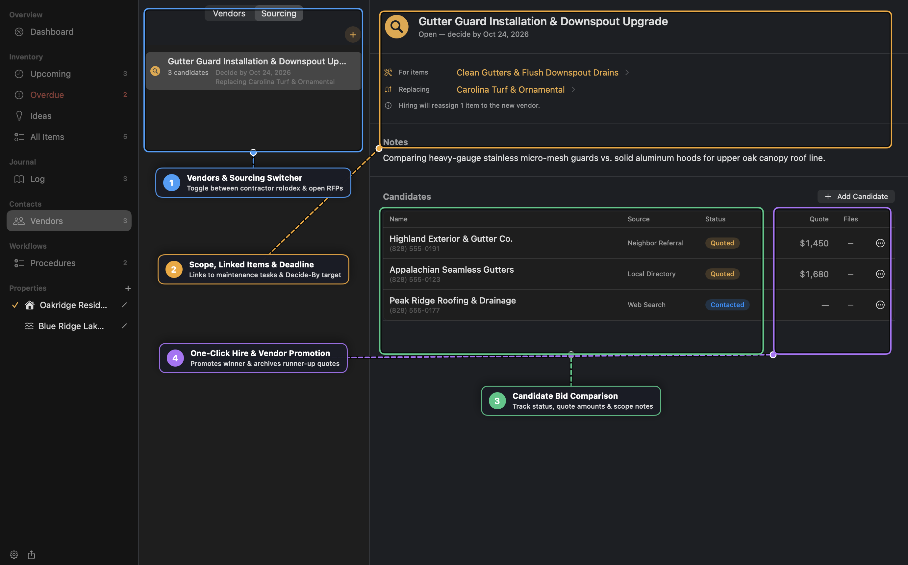
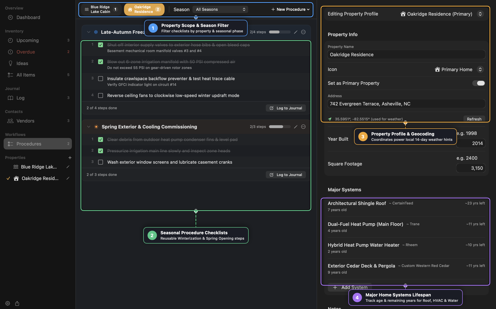

# Upkeep Practical Cookbook

This cookbook walks through six real-world home maintenance workflows in **Upkeep**, from multi-stage agronomic lawn programs and weather-timed exterior work to competitive contractor RFPs, seasonal mountain cabin winterization, and multi-machine household sync.

---

## Recipe 1: Building a Multi-Stage Agronomic Lawn Program with Sub-Events

Instead of cluttering your inventory with 6 to 13 separate lawn-care items, model your entire annual turf schedule inside a single **Multi-Event Maintenance Item** with timed **Sub-Events** and consumable **Supply** tracking.

### Step-by-Step
1. Press `Cmd+N` to create a new Maintenance Item:
   - **Name**: `Annual Cool-Season Lawn Care Program`
   - **Category**: `Lawn & Garden`
   - **Schedule**: `Seasonal` (`Mar 1 – Nov 30`)
   - **Tags**: `lawn`, `spray`, `fertilizer`, `outdoor` (the `spray` and `outdoor` tags activate inline 14-day weather spray hints).
2. Enable **Supply Tracking** inside the item editor:
   - **Product Name**: `Lesco 24-0-11 50% PolyPlus Slow-Release (50 lb)`
   - **Stock on Hand**: `4` bags
   - **Quantity per Use**: `2` bags
   - **Unit Cost**: `$64.00`
3. Under **Sub-Events (Multi-Event Schedule)**, add each timed treatment stage:
   - *Stage 1: Pre-Emergent Crabgrass Barrier* (`Mar 1 – Apr 10`)
   - *Stage 2: Spring Slow-Release Nitrogen & Iron Feed* (`May 1 – Jun 5`)
   - *Stage 3: Fall Core Aeration & Tall Fescue Overseeding* (`Sep 1 – Oct 15`) — assign your aeration contractor (*Carolina Turf & Ornamental*) directly to this stage's **Vendor Override**.
   - *Stage 4: Late-Fall Winterizer Root Builder* (`Nov 5 – Dec 10`)
4. When you complete a stage, click the **Log** checkmark next to that specific sub-event. Upkeep records a `LogEntry` tied to that `subEventID`, offers to deduct `2` bags from your supply stock, and leaves the remaining stages scheduled for their upcoming windows.

---

## Recipe 2: Timing Exterior & Spray Applications with the 14-Day Weather Engine

Applying pre-emergent herbicides, liquid iron, deck stain, or exterior caulk right before high winds or heavy rain wastes materials and ruins finishes. Upkeep's **Weather Widget** and **Item Weather Hint** automate spray-window selection.

### Step-by-Step
1. Open your **Property Profile** in the sidebar under **Properties** and enter your property's street address (or city/state).
2. Verify the green location badge (`used for weather`) appears below the address field—Upkeep geocodes the address locally via macOS Core Location and queries **Open-Meteo** without requiring an API key.
3. Open **Dashboard** and inspect the **Weather** card on the right:
   - **Next Rain Advisory**: Displays the next forecast day with `≥ 50%` precipitation probability or `≥ 0.05"` expected rainfall.
   - **Good for Spraying / Painting**: Highlights the longest contiguous multi-day window of dry weather with sustained winds `< 10 mph` and gusts `< 15 mph`.
4. Click any day in the 14-day strip to open the **Hourly Weather Breakdown** (temperature, feels-like, dew point, wind gusts, UV index, and barometric pressure) and pick the calmest morning hours for your application.

---

## Recipe 3: Running a Competitive Contractor RFP & Replacing an Incumbent Vendor

When replacing an underperforming contractor or collecting multiple bids for a capital project (such as installing micro-mesh gutter guards or replacing a heat pump), use **Vendor Sourcing** to manage the entire RFP lifecycle.

### Step-by-Step
1. Navigate to **Vendors** in the sidebar, switch the segmented tab to **Sourcing**, and click `+` (**New Sourcing**).
2. Configure the sourcing scope:
   - **Title**: `Gutter Guard Installation & Downspout Upgrade`
   - **For Items**: Select `Clean Gutters & Flush Downspout Drains` (and any other affected maintenance items).
   - **Replacing Vendor**: Select the incumbent contractor you are replacing.
   - **Decide By**: Set a target decision date (Upkeep schedules a macOS notification reminder for 9:00 AM on your deadline).
3. Add 2–4 **Candidates** (or click **Pick from Contacts…** to import contractor vCards from macOS Contacts).
4. As quotes arrive, update each candidate's status to **Quoted**, enter their dollar **Quote Amount**, and attach their PDF estimate.
5. Click the `⋯` menu on the winning bid and select **Hire…**:
   - Confirm whether to create a new active Vendor record or link to an existing Vendor.
   - Upkeep automatically marks the incumbent vendor **Inactive**, reassigns all linked maintenance items to the newly hired vendor, and archives the runner-up **Quoted** candidates as inactive vendors so their contact info and bid history are never lost.

---

## Recipe 4: Executing & Resetting Seasonal Winterization Checklists Across Properties

For multi-step seasonal rituals—such as closing down a mountain lake cabin before the first hard freeze or commissioning irrigation and cooling in the spring—use **Procedures**.

### Step-by-Step
1. Select **Procedures** under *Workflows* in the sidebar.
2. Click **New Procedure** in the top-right bar to start from a built-in template (*Winterization Checklist*, *Spring Opening*, *Seasonal Prep*, or *Home Inspection*) or create a custom procedure.
3. Scope the procedure to one or more properties (e.g., *Oakridge Residence* and *Blue Ridge Lake Cabin*) and assign a **Seasonal Window** (`Oct 15 – Nov 30`).
4. Drag and drop steps to match your physical walkthrough order (e.g., *Shut off interior manifold valves* → *Blow out 6-zone irrigation lines at 50 PSI* → *Insulate backflow preventer & verify GFCI heat trace*).
5. Link relevant steps to inventory items so you can jump straight to the underlying equipment specs or vendor contact.
6. Once all steps are checked off, click **Log to Journal** at the bottom of the procedure card to record a permanent completion entry. Next autumn, click `⋯` → **Reset All Steps** to reuse the exact checklist.

---

## Recipe 5: Tracking Progress Notes Without Resetting Schedules

Sometimes you want to record an interim observation—such as measuring HVAC static pressure, noting a serial number, or logging a partial repair—without resetting a recurring item's countdown timer or auto-closing a To-do.

### Step-by-Step
1. Open the item in **All Items** and click **Log Completion** (or press `Cmd+Shift+N`).
2. Enter your measurement notes, cost (if any), and attach photos of the equipment nameplate or inspection report.
3. Uncheck **Counts as completion** (`Progress note — won't reset schedule or complete a to-do`).
4. Click **Save**. The entry appears in the item's **Completion History** and the global **Log** with a `Progress note` badge, while the item's next-due date remains untouched.

---

## Recipe 6: Auditing Capital System Lifespans & Setting Up Household Cloud Sync

### Part A: Major System Lifespan Planning
1. Click your property under **Properties** in the sidebar to open **Property Profiles**.
2. Scroll to **Major Systems** and click **Add System** for each capital asset:
   - *Architectural Shingle Roof* (Installed 2019, Expected Lifespan: `30` years)
   - *Dual-Fuel Heat Pump* (Installed 2022, Expected Lifespan: `15` years)
   - *Hybrid Heat Pump Water Heater* (Installed 2024, Expected Lifespan: `12` years)
3. Upkeep displays each system's current age and remaining years (`~23 yrs left`), shifting the badge tint to **Amber** when `≤ 5` years remain and **Red** once past expected lifespan so you can budget replacements ahead of failure.

### Part B: Multi-Mac Household Sharing
1. Create a shared `UpkeepData` folder inside Google Drive, iCloud Drive, or Syncthing.
2. Open **Settings** (`Cmd+,`) → **Data Location** → **Change…** and select the shared folder on each household member's Mac.
3. Under **Household Members**, add each person and select the active member on each machine.
4. Use the sidebar's **My Tasks** toggle to filter the inventory to items you own, and rely on Upkeep's automatic per-item version check (`ConflictBanner`) to detect and resolve concurrent edits safely.
